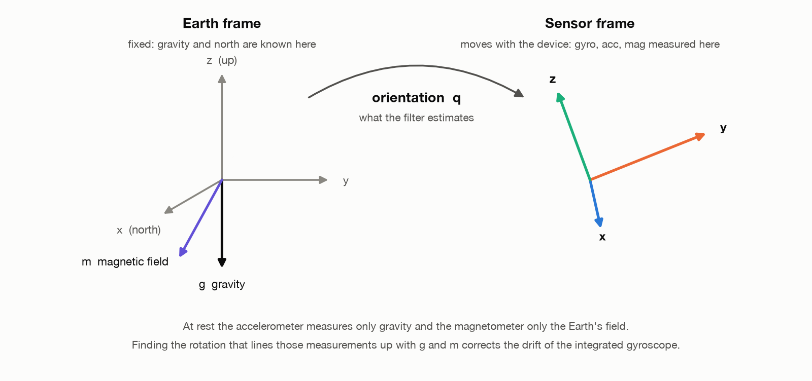
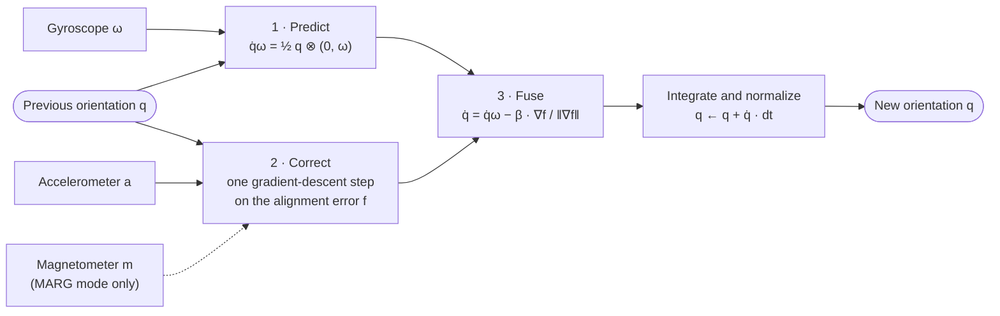
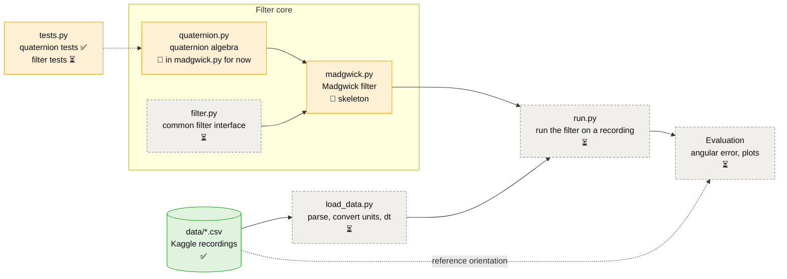
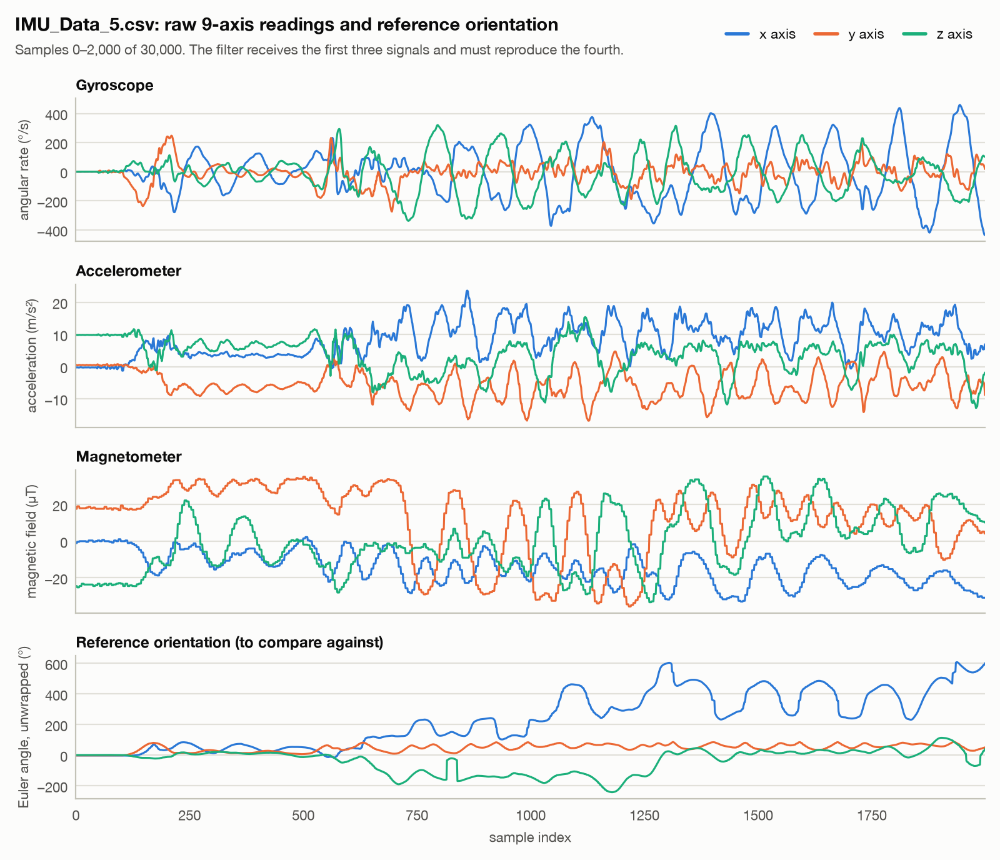
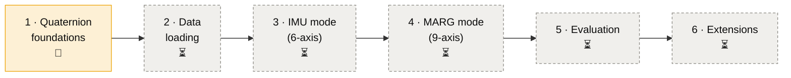

# Madgwick Filter

A from-scratch Python implementation of the **Madgwick orientation filter**. It estimates a sensor's 3D orientation, as a quaternion, from a gyroscope and an accelerometer (IMU, 6-axis), optionally with a magnetometer (MARG, 9-axis). Everything is built by hand, quaternion algebra included, and checked against reference orientations from real recordings.

## How it works

The filter estimates the rotation `q` between the sensor frame, where the readings are taken, and a fixed Earth frame, where gravity and north are known.

<picture>
  <source media="(prefers-color-scheme: dark)" srcset="docs/images/frames_dark.png">
  
</picture>

At each sample:

1. **Predict:** integrate the gyroscope, `q̇ω = ½ q ⊗ (0, ω)`. This is accurate over short periods but drifts.
2. **Correct:** take one gradient-descent step that aligns the measured gravity (and, in MARG mode, the magnetic field) with the Earth frame.
3. **Fuse:** combine both with a single gain `β`, integrate over `dt` and normalize.



## Current state



✅ done · 🚧 in progress · ⏳ not started

- **Working and tested** (`tests.py`): Hamilton product, scalar `*` and `/`, conjugate, norm, inverse.
- **Known issues:**
  - `__add__` adds `other` instead of `other.w`, `other.x`, … so `q + p` raises a `TypeError`.
  - `Madgwick` starts from the zero quaternion. It should start from the identity `(1, 0, 0, 0)`.
- **Filter:** only the gyroscope prediction step is started.

## Dataset

[IMU Data for AI](https://www.kaggle.com/datasets/banaankiamanesh/imu-for-ai) (Kaggle): 8 recordings of 30,000 samples, each with raw readings and a reference orientation (Euler angles and quaternion). `IMU_Data_1–5.csv` are 9-axis. `IMU_Data_1–3(No Mag).csv` are separate 6-axis recordings.

<picture>
  <source media="(prefers-color-scheme: dark)" srcset="docs/images/dataset_overview_dark.png">
  
</picture>

Units, inferred from the values: gyroscope °/s, accelerometer m/s², magnetometer µT, Euler angles °. `Quat_0` is the scalar part `w`. When loading:

- Convert the gyroscope to rad/s.
- Strip the space-padded header of `IMU_Data_1.csv`.
- Find the sampling rate, which the files don't give, to get `dt`.
- Normalize the reference quaternions (norms range from 0.96 to 1.04, and `IMU_Data_5.csv` has one near zero) and compare them up to sign, since `q` and `−q` are the same rotation.

## Roadmap



1. **Quaternion foundations:** fix `__add__`; add `__sub__`, `__neg__`, `normalize()`, vector rotation and Euler conversion; move the class to `quaternion.py`.
2. **Data loading** (`load_data.py`): parse the files, convert units, get `dt`, clean the references.
3. **IMU mode:** prediction, gradient-descent correction with the accelerometer, fusion with `β`. Validate on the No Mag recordings.
4. **MARG mode:** add the magnetometer term and magnetic distortion compensation, and optionally gyroscope bias compensation (`ζ`).
5. **Evaluation** (`run.py`): angular error `2·acos(|⟨q_est, q_ref⟩|)`, Euler RMSE, plots, tuning `β`.
6. **Extensions:** compare other filters (complementary, Mahony, EKF) through `filter.py`; speed things up with NumPy.

## Usage

Python 3, standard library only. The filter can't run yet.

```bash
python -m unittest tests -v    # run the quaternion tests
python docs/make_figures.py    # regenerate the README figures (needs numpy and matplotlib)
```

## References

- S. O. H. Madgwick, *An efficient orientation filter for inertial and inertial/magnetic sensor arrays*, technical report, University of Bristol, 2010.
- S. O. H. Madgwick, A. J. L. Harrison, R. Vaidyanathan, *Estimation of IMU and MARG orientation using a gradient descent algorithm*, IEEE ICORR, 2011.
